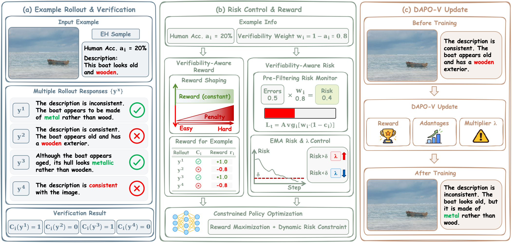

# RL-Verifiability

**More Powerful, Less Verifiable? Mitigating Hard-to-Verify Hallucinations in MLLM's Reinforcement Learning**

[Installation](#installation) · [Training](#training) · [Evaluation](#evaluation)  
[🤗 Hugging Face](https://huggingface.co/datasets/BeEnough/ITHV) · [🤖 ModelScope](https://www.modelscope.cn/datasets/Nothing07/ITHV)

## Overview

> How does reinforcement learning affect the errors that humans struggle to detect? This project studies hallucination mitigation beyond overall correctness, using human verification feedback to guide policy learning.

> - **ITHV** (Image-Text Hallucination Verifiability Dataset) combines image-grounded tasks with human verification annotations, distinguishing obvious hallucinations (OH), elusive hallucinations (EH), and non-hallucinated examples (NH).
> - **Verifiability-aware policy optimization** maximizes correctness while controlling error risk on questions with lower human verification accuracy. An adaptive Lagrangian multiplier adjusts the penalty strength during training.
> - **DAPO-V and GRPO-V** integrate this reward with multimodal policy learning. DAPO-V additionally monitors risk before dynamic group filtering.

<p align="center">
  
</p>

### Supported models and methods

| Backbone | Training recipes |
| --- | --- |
| Qwen2.5-VL-3B-Instruct | DAPO, DAPO-V |
| Qwen2.5-VL-7B-Instruct | DAPO, DAPO-V |
| LLaVA-OneVision-1.5-8B-Instruct | DAPO, DAPO-V, GRPO, GRPO-V |

## Installation

Run the following commands from the repository root. Use separate environments for policy training/evaluation and the frozen judge.

### Policy environment

The reference environment uses Python 3.10, PyTorch 2.8.0, Transformers 4.57.6, vLLM 0.11.0, and PEFT 0.21.0.

```bash
python3.10 -m venv .venv-policy
source .venv-policy/bin/activate
python -m pip install --upgrade pip setuptools wheel
python -m pip install -r requirements.txt
python -m pip install --no-build-isolation -r requirements/attention.txt
python -m pip install --no-deps -e .
```

### Judge environment

The frozen Qwen3.5-9B judge uses Python 3.11 and a separate set of dependencies:

```bash
python3.11 -m venv .venv-judge
source .venv-judge/bin/activate
python -m pip install --upgrade pip
python -m pip install -r requirements/judge.txt
```

Download the desired backbone and Qwen3.5-9B weights, and supply their local directories in the commands below.

## Data preparation

ITHV annotations are available on **[🤗 Hugging Face](https://huggingface.co/datasets/BeEnough/ITHV)** and **[🤖 ModelScope](https://www.modelscope.cn/datasets/Nothing07/ITHV)**.

Training and evaluation use the fixed JSONL splits in `data/ithv/`.  
Each JSONL record contains eight fields:

```json
{
  "prompt": "<image>\nAn image-grounded question.",
  "question": "An image-grounded question.",
  "answer": "The reference answer.",
  "images": ["AMBER/images/AMBER_1.jpg"],
  "acc": 0.4,
  "task_type": "short_answer",
  "hallucination_type": "elusive",
  "sample_id": "example_0001"
}
```

`acc` is the empirical human accuracy. NH examples use `acc: null` and `hallucination_type: "not_applicable"`; OH and EH use `"obvious"` and `"elusive"`.

Obtain the source images from [AMBER](https://github.com/junyangwang0410/AMBER) and [RealWorldQA](https://huggingface.co/datasets/xai-org/RealworldQA). Arrange them under a common image root:

```text
IMAGE_ROOT/
├── AMBER/
│   └── images/
└── RealworldQA/
    └── data/
        └── images/
```

Validate the splits and image paths:

```bash
python -m examples.ithv.data --image-root /path/to/IMAGE_ROOT
```

Use `--data-dir /path/to/ithv_splits` to select another directory containing the same three JSONL filenames and schema.

## Training

### Start the frozen judge

In a separate terminal, activate the judge environment and start the server:

```bash
source .venv-judge/bin/activate
JUDGE_GPU=3 JUDGE_MODEL=/path/to/qwen3.5-9b \
  bash examples/ithv/start_judge.sh
```

The default endpoint is `http://127.0.0.1:8003`. Normalized exact matches are accepted directly; other responses are graded by the frozen judge using the image, question, reference answer, and complete candidate response. The judge returns a Boolean correctness verdict. Its grading prompt is defined in [ithv.py](examples/reward_function/ithv.py).

### DAPO-V

In the policy environment:

```bash
source .venv-policy/bin/activate
python -m examples.ithv.train \
  --recipe dapo_v \
  --backbone qwen25_3b \
  --model-path /path/to/qwen2.5-vl-3b-instruct \
  --judge-model /path/to/qwen3.5-9b \
  --image-root /path/to/IMAGE_ROOT \
  --gpus 0,1 \
  --output-dir outputs/qwen25_3b_dapo_v
```

For Qwen2.5-VL-7B or LLaVA-OneVision-1.5-8B, change `--backbone`, `--model-path`, and `--output-dir` accordingly. Override the risk budget with `--risk-budget`.

### GRPO-V

```bash
python -m examples.ithv.train \
  --recipe grpo_v \
  --backbone llava_ov15_8b \
  --model-path /path/to/llava-onevision-1.5-8b-instruct \
  --judge-model /path/to/qwen3.5-9b \
  --image-root /path/to/IMAGE_ROOT \
  --gpus 0,1 \
  --output-dir outputs/llava_grpo_v
```

Set `--recipe dapo` or `--recipe grpo` and use a separate output directory to train the corresponding accuracy-only baseline.

### Configuration

| Setting | Default |
| --- | --- |
| LoRA rank / alpha | 64 / 64 |
| Learning rate / warmup ratio | `1e-5` / 0.03 |
| Responses per prompt | 8 |
| Prompt groups per outer step | 63 |
| Prompt groups per optimizer mini-batch | 21 |
| Optimizer updates per outer step | 3 |
| Maximum prompt / response length | 2048 / 256 tokens |
| Training temperature / top-p | 1.0 / 1.0 |
| Checkpoint interval | Every 5 outer steps |
| Random seed | 42 |

| Recipe | Group standard-deviation normalization | Dynamic filtering | Reference KL coefficient |
| --- | --- | --- | --- |
| DAPO | Yes | Yes | 0 |
| DAPO-V | No | Yes | 0 |
| GRPO | Yes | No | 0.04 |
| GRPO-V | No | No | 0.04 |

The adaptive controller uses an initial multiplier of `0.5 * p_H`, update rate 0.1, EMA coefficient 0.8, and multiplier cap 1, where `p_H` is the fraction of training instances with human accuracy annotations. DAPO-V monitors the first 66 raw prompt groups per outer step; GRPO-V monitors the unfiltered batch of 63 groups.

See [main.yaml](configs/main.yaml) for shared settings and [train.py](examples/ithv/train.py) for recipe-specific settings. Add `--wandb` to enable Weights & Biases or `--dry-run` to inspect the configuration before launching.

vLLM runs within the policy workers. Assign the judge a GPU outside the policy's `--gpus` list. The policy GPU count must divide the 168-response optimizer mini-batch.

### Resume training

Rerun the same training command with `--resume`, keeping the output directory, GPU count, model paths, and data paths unchanged. Checkpoints retain LoRA adapters and the optimizer, scheduler, RNG, dataloader, training-step, and adaptive-controller states.

## Evaluation

Use validation to select a checkpoint, then evaluate that checkpoint on the test split.

### Validation

```bash
python -m examples.ithv.evaluate \
  --recipe dapo_v \
  --run-dir outputs/qwen25_3b_dapo_v --step 65 \
  --model-path /path/to/qwen2.5-vl-3b-instruct \
  --judge-model /path/to/qwen3.5-9b \
  --image-root /path/to/IMAGE_ROOT --gpu 0 \
  --split validation \
  --output-dir outputs/eval_qwen25_3b_val
```

### Test

First evaluate the pretrained backbone to obtain the reference accuracies:

```bash
python -m examples.ithv.evaluate \
  --recipe base \
  --model-path /path/to/qwen2.5-vl-3b-instruct \
  --judge-model /path/to/qwen3.5-9b \
  --image-root /path/to/IMAGE_ROOT --gpu 0 \
  --split test \
  --output-dir outputs/eval_qwen25_3b_base_test
```

Then evaluate the selected policy checkpoint with the matching backbone summary:

```bash
python -m examples.ithv.evaluate \
  --recipe dapo_v \
  --run-dir outputs/qwen25_3b_dapo_v --step 65 \
  --model-path /path/to/qwen2.5-vl-3b-instruct \
  --judge-model /path/to/qwen3.5-9b \
  --image-root /path/to/IMAGE_ROOT --gpu 0 \
  --split test \
  --base-summary outputs/eval_qwen25_3b_base_test/summary.json \
  --output-dir outputs/eval_qwen25_3b_dapo_v_test
```

GRPO and GRPO-V use the same evaluation entry point with their corresponding recipe and training directory.

## Acknowledgements

Our implementation builds on [EasyR1](https://github.com/hiyouga/EasyR1) and [veRL](https://github.com/volcengine/verl). We thank their contributors for the training framework, and the [AMBER](https://github.com/junyangwang0410/AMBER) and [RealWorldQA](https://huggingface.co/datasets/xai-org/RealworldQA) teams for the source datasets.